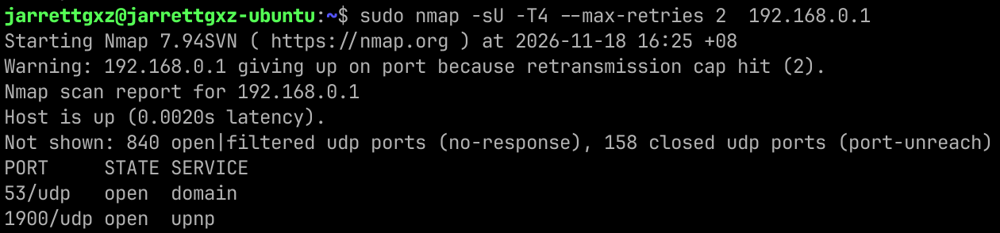

# Case study 1 (Linksys E1200 router)

**Refer here for the full research on this router:**



This router has been used in a real-life malware/botnet campaign named "TheMoon". The Home Network Administration Protocol (HNAP) service (discussed later on) was used by this malware to discover vulnerable targets. You may read more about it here:






Details on the /HNAP1 endpoint (to discover specific model name and firmware version



More details on the Home Network Administration Protocol (HNAP)



### Basic Nmap scans

#### TCP scan

```shellscript
$ nmap -sS -p- <TARGET> # scan all TCP ports 
```

<figure><figcaption></figcaption></figure>

* http (80/tcp)
* 1780/tcp, 1990/tcp
  * both are found to be serving UPnP XML files (more on this later)

#### UDP scan

```shellscript
# scan UDP ports
$ nmap -sU -p- --top-ports 20 <TARGET> 
$ nmap -sU -T4 --max-retries 2 <TARGET>
```

<figure><figcaption></figcaption></figure>

<figure><figcaption></figcaption></figure>

* domain (53/udp)
* upnp (1900/udp)

#### OS detection, script, version scans (`-A`)

```shellscript
$ nmap -A <TARGET> # scan all TCP ports 

# equivalent to
$ nmap -O -sV -sC --traceroute <TARGET>
```

<figure><figcaption></figcaption></figure>

* **Linksys E1200** WAP (Wireless Access Point)
* **Linux 2.6.22** (based on Nmap fingerprinting database)
  * this is the actual Linux kernel version running on this router

Notice that Nmap also ran a few HTTP scripts: http-auth, http-title, http-server-header&#x20;

### Nmap script scans (NSE)

Due to certain issues with the existing scripts, I have modified a few of them to get better results:





Place the scripts in the following location to override the default one (this is where Nmap will look for scripts before the default ones in `/usr/share/nmap):`

* `~/.nmap/scripts/hnap-info.nse`
* `~/.nmap/nselib/upnp.lua`

#### Universal Plug-n-Play (UPnP)

```shellscript
$ nmap --script broadcast-upnp-info <TARGET>
$ nmap -sU -p1900 --script upnp-info <TARGET>
```

<figure><figcaption></figcaption></figure>

<figure><figcaption></figcaption></figure>

> Ensure to specifiy the network interface name with the `-e` flag (**ens33** in my case)

We can see the that the URL at TCP port 1780 (`/InternetGatewayDevice.xml`) provides us with information about the device

#### Home Network Administration Protocol (HNAP)

```shellscript
$ nmap --script hnap-info <TARGET>
$ curl http://<TARGET>/HNAP1 # alternative method
```

<figure><figcaption></figcaption></figure>

We can discover the specific firmware build for this router: **2.0.02 build 3.** Along with a long list of SOAP actions
