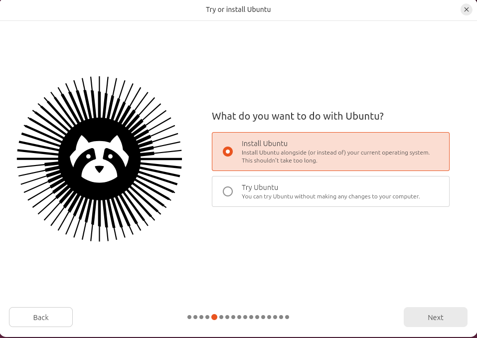

# Installing Ubuntu

### **Setting up a Linux virtual machine (Ubuntu on VirtualBox)**



1. **Install the VirtualBox application**

* Select according to your host machine type

<figure><figcaption></figcaption></figure>


2. **Download the Ubuntu virtual machine image**

_**2.1 Windows**_

* Visit [https://ubuntu.com/download/desktop](https://ubuntu.com/download/desktop) and download the file under "Intel or AMD 64-bit architecture"

_**2.2 MacOS**_

* Visit [https://ubuntu.com/download/desktop](https://ubuntu.com/download/desktop) and download the file under "ARM 64-bit architecture


3. **Installation of downloaded Ubuntu image**&#x20;

**Open the VirtualBox application**

<figure><figcaption></figcaption></figure>

* Select the "New" option

**Installation steps**

<figure><figcaption></figcaption></figure>

* **Name**: any name of choice
* **Folder**: select a folder of choice (note that I am running from a Linux host so the folder naming is different from Windows)
* **ISO Image**: select the downloaded `.iso` file from previous step
* **Type**: Linux
* **Subtype**: Ubuntu
* **Version**: Ubuntu (64-bit)

> Check the "Skip Unattended Installation" option (NOT yet checked in the image above)

Move through with the installation steps. Select "Install Ubuntu" and proceed with the defaults

<figure><figcaption></figcaption></figure>

Select "Erase disk and install Ubuntu". This will not affect your host operating system.

<figure><figcaption></figcaption></figure>

Wait for the installation steps to complete. Please be patient as this step may take awhile.

<figure><figcaption></figcaption></figure>

Select "Restart now"

<figure><figcaption></figcaption></figure>

To shutdown: Click 'X' button on top right hand corner -> "Send the shutdown signal" -> "OK"

<figure><figcaption></figcaption></figure>


### **Additional configuration steps**

1. **Enable full screen mode**

...

2. **Install Guest Additions CD image**

* From the top menu bar: Devices -> Install Guest Additions CD image

<figure><figcaption></figcaption></figure>

This will insert a new drive named "VBox\_GAs\_x.xx.xx" depending on the specific version

<figure><figcaption></figcaption></figure>

Open that drive in the terminal

<figure><figcaption></figcaption></figure>

Run the `.run` file depending on your host machine :

* `VBoxLinuxAdditions.run`: Windows host machine
* `VBoxLinuxAdditions.runarm64`: MacOS host machine

Run the packge update and install some necessary tools first

<figure><figcaption></figcaption></figure>

```bash
sudo apt update
sudo apt install bzip2 tar build-essential dkms

./VboxLinuxAdditions.run
```

> **Note**: Adding `build-essential` and `dkms` ensures your system has the proper compiler tools to build the display drivers correctly
